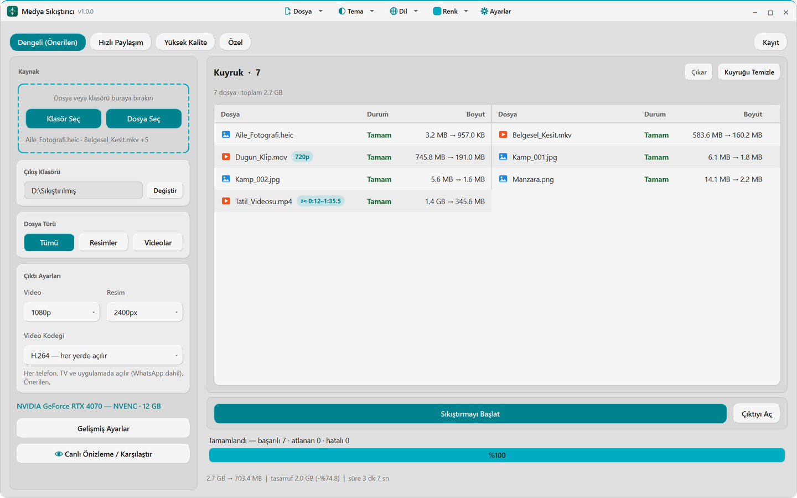
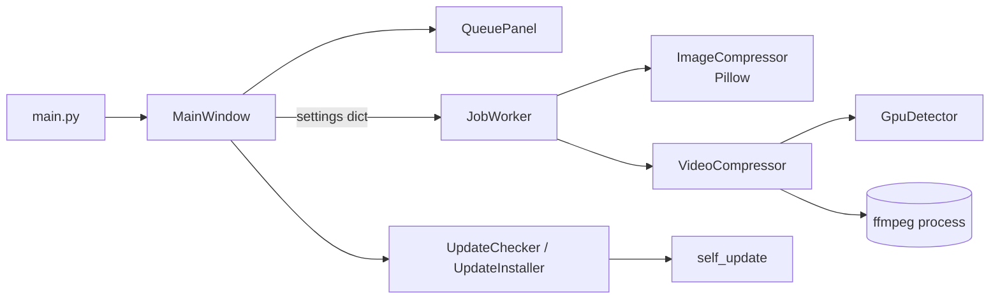

<div align="center">

English | [Türkçe](README.tr.md)

# MediaCompressor

**Shrink phone and camera photos and videos to a size you can share or archive, with FFmpeg and optional GPU encoding.**


<picture>
  <source media="(prefers-color-scheme: dark)" srcset="docs/images/mediacompressor-dark.webp">
  
</picture>

</div>

> The window above shows made-up file names and sizes. The interface is available in Turkish and English; the screenshot uses Turkish.

## Highlights

- **One queue for photos and videos.** Drop files or whole folders; every file shows its own status and size change, and the job ends with a total saving and the elapsed time.
- **Profiles instead of knobs.** Balanced (recommended), Quick Share, High Quality and Custom. Changing any value by hand switches the profile to Custom.
- **Video with H.264, HEVC or AV1.** H.264 output is always 8-bit 4:2:0, so 10-bit sources such as iPhone HDR clips become files that open on common devices. Videos are never upscaled.
- **GPU encoding when it works, CPU when it does not.** NVIDIA NVENC, AMD AMF and Intel QSV are detected automatically; a failed hardware attempt is retried and finally falls back to the CPU encoder.
- **Live preview and compare.** Move the quality slider and see the result; hold Space to flip to the original.
- **Trim and per-file exceptions.** Compress only part of a video, or give selected files their own resolution, frame rate or audio setting.
- **Nothing is overwritten.** Outputs are written to a temporary file and renamed when complete; a file that already exists in the output folder is skipped. Originals are never touched or deleted.

## Features

### Video

| Setting | What you can choose |
| --- | --- |
| Input containers | `.mp4`, `.mov`, `.mkv`, `.avi`, `.m4v` |
| Codec | H.264 (plays everywhere), HEVC / H.265 (smaller at the same quality), AV1 (smallest, needs recent devices) |
| Quality | Automatic bitrate driven by a CRF value, or a fixed bitrate (1500k, 2000k, 2500k, 4000k) |
| Maximum resolution | 720p, 1080p, 1440p, Original, or a value you type. It only limits the width; smaller videos stay as they are |
| Frame rate | Original, 60, 30, 25 or 24 fps. It can only lower the frame rate |
| Audio | 96k, 128k or 192k, or remove the audio completely |
| Speed preset | From "Super fast" to "Slower", default "Slow" (better compression) |
| Trim | Right-click a video, **Trim…**: pick a start and an end (frames at both ends are shown); only that part is compressed |

Container handling: the extension is kept. `.avi` always becomes `.mp4`, and `.mov` becomes `.mp4` when AV1 is selected, because those containers cannot carry the result. If the output would not be smaller than the source, the original is copied instead (not when you trimmed or removed audio).

### Images

| Setting | What you can choose |
| --- | --- |
| Input formats | JPEG, PNG, WebP, HEIC / HEIF, AVIF, JPEG XL |
| Quality | Automatic (chosen from the file size) or a fixed value |
| Maximum size | 1920 px, 2400 px, 3840 px, Original, or a value you type; applies to the longest side |
| Output format | JPEG stays JPEG, WebP stays WebP, AVIF stays AVIF, JPEG XL stays JPEG XL. HEIC / HEIF and PNG files without transparency become JPEG; PNG files with transparency stay PNG (palette) |
| Metadata | EXIF orientation is applied; EXIF and the ICC profile are kept for JPEG output, the ICC profile for the other formats |

The live preview can compare JPEG, WebP, AVIF and JPEG XL for the same image before you commit to a quality value.

### Queue and workflow

| Feature | Details |
| --- | --- |
| Adding files | Drag and drop, **File** menu (**Choose Files…**, **Choose Folder…**), subfolders optional |
| Queue | Drag to reorder, remove entries (the original file is not deleted), **Retry Failed**, two columns when the window is wide |
| Exceptions | Right-click selected files, **Apply Exception**: own resolution, frame rate or audio (keep / remove). Also possible for files that have not started yet while a job runs |
| Remaining time | Estimated from the amount of work (bytes), with images and videos measured separately; shown after the first 1% |
| Output | The folder you pick, or a `compressed` folder on the Desktop (`sıkıştırılmış` when the interface is Turkish) |
| Settings | Resolution, codec, quality, audio, frame rate, speed, GPU and the rest are remembered between launches |
| Tray | The app lives in the system tray; closing the window hides it. Tray menu: Show/Hide, Settings, Theme, Language, Exit. Desktop notification when a job finishes |
| Appearance | System, light or dark theme, several accent colors, Turkish and English |

### Updates and notices

When automatic checks are on, the app asks `macik.com.tr` once a day whether a newer version exists. If one does, an **Update · vX** button appears in the title bar and in the tray menu; the update is downloaded, verified against the SHA-256 checksum the server provides, unpacked and swapped in place. With **Install Updates Automatically** it happens in the background while the app is idle. If a new version fails to start twice, the previous one is restored and that version is not offered again. The server can also send a one-line notice that is shown above the window and can be dismissed.

Both switches are in **Settings**. A source checkout or a build of your own checks the same address; change `UPDATE_CHECK_URL` and `UPDATE_ALLOWED_HOSTS` in `src/core/app_info.py` if you do not want that.

## Installation

### Ready-made executable

Download the Windows build from **<https://macik.com.tr>**. It is a single `.exe`; no installer is needed.

### From source

Requires Python 3.13 (the version the code is developed and tested on).

```powershell
git clone https://github.com/Aseloth99/mediacompressor.git
cd mediacompressor
py -3.13 -m pip install -r requirements.txt
py -3.13 main.py
```

`requirements.txt` also lists PyInstaller, which is only needed to build the executable.

### FFmpeg

FFmpeg is not part of this repository. The app looks for `ffmpeg` and `ffprobe` on your `PATH` first, then in its own data folder (`%LOCALAPPDATA%\MediaCompressor\ffmpeg`), next to the app (also in an `ffmpeg` or `ffmpeg\bin` subfolder) and, on macOS and Linux, in the usual install locations (Homebrew, `/usr/bin`, ...).

- **Windows:** if nothing is found, a banner offers **Download FFmpeg**. It fetches the "release-essentials" build from [gyan.dev](https://www.gyan.dev/ffmpeg/builds/), checks it against the SHA-256 file published next to it, and installs it into the app's data folder. Nothing is downloaded until you click the button. You can also put your own FFmpeg on the `PATH` and press **Scan Again** (`F5`).
- **macOS / Linux:** install FFmpeg with your package manager (`brew install ffmpeg`, `sudo apt install ffmpeg`, ...) and press **Scan Again**.

Images work without FFmpeg; videos need it. The FFmpeg builds you download or install carry their own license terms.

## Usage

1. Drop photos, videos or folders on the window, or use **Choose Files** / **Choose Folder**.
2. Pick a profile. For finer control open **Advanced Settings** (bitrate, quality, speed, audio, frame rate, GPU) or set the codec and resolutions on the main screen.
3. Check the output folder, then press **Start Compression**. **Stop** ends the job; files already finished stay.
4. When it is done, **Open Output** shows the results; **Retry Failed** queues the files that failed.

Right-click a queue entry for **Live Preview / Compare**, **Trim…** (videos), **Apply Exception**, **Show in Folder** and **Open File**.

Command line: `MediaCompressor.exe --minimized` (or `py -3.13 main.py --minimized`) starts hidden in the tray. This is what **Start at Login** uses. Starting a second copy brings the running one to the front.

### Keyboard shortcuts

| Shortcut | Action |
| --- | --- |
| `Ctrl+O` | Choose files |
| `Ctrl+Shift+O` | Choose a folder |
| `Ctrl+,` | Settings |
| `F1` | About |
| `F5` | Scan for FFmpeg again |
| `Ctrl+Q` | Quit (the window's close button and `Alt+F4` hide it to the tray) |
| `Delete` / `Backspace` | Remove the selected queue entries |
| `Space` (held, in the preview) | Show the original instead of the compressed result |

### Settings

| Where | Option |
| --- | --- |
| Settings | Language (Auto, Türkçe, English), Theme (System, Dark, Light), Color |
| Settings | Start at Login (off by default), Show Notifications |
| Settings | Check for Updates Automatically, Install Updates Automatically, Check for Updates |
| Main window | Profile, File Type, Output Folder, Video and Image limits, Video Codec, Open Folder When Finished |
| Advanced Settings | Bitrate, Quality (CRF), Processing Speed, Audio, Frame Rate, GPU, Remove Audio, Process Subfolders, Automatic Image Quality |

Settings live in `%APPDATA%\MediaCompressor\config.json`; logs and crash reports in `%LOCALAPPDATA%\MediaCompressor\logs`. On macOS and Linux the app uses `~/Library/Application Support` and `~/Library/Logs`, or the XDG folders.

## Architecture

```
mediacompressor/
├── main.py                  entry point: single-instance lock, theme, tray, update checker
├── MediaCompressor.spec     PyInstaller spec (Windows, single file, windowed)
├── pack_dist.py             zips dist\MediaCompressor.exe into dist\MediaCompressor.zip
├── version_info.txt         Windows version resource (a test keeps it equal to app_info.VERSION)
├── requirements.txt
├── assets/icons/            application icon
├── docs/images/             README screenshots
├── src/
│   ├── core/                compression engine
│   │   ├── app_info.py          name, version, update address, folder names
│   │   ├── ffmpeg_manager.py    find / download (SHA-256 checked) FFmpeg
│   │   ├── gpu_detector.py      NVENC, AMF, QSV, VAAPI, VideoToolbox probing and fallbacks
│   │   ├── video_compressor.py  FFmpeg command building, progress parsing, GPU to CPU fallback
│   │   ├── image_compressor.py  Pillow / piexif pipeline (JPEG, PNG, WebP, HEIC, AVIF, JPEG XL)
│   │   ├── job_manager.py       JobWorker: runs the queue, parallel images, per-file exceptions
│   │   ├── atomic_output.py     temp file + rename writes
│   │   ├── eta.py               work-weighted remaining-time estimate
│   │   └── workers.py           background worker base and safe shutdown
│   ├── gui/                 PyQt6 interface
│   │   ├── main_window.py       main window, profiles, settings collection, update flow
│   │   ├── queue_panel.py       queue list and its context menu
│   │   ├── preview_dialog.py    live preview and compare
│   │   ├── trim_dialog.py       trim a video
│   │   ├── advanced_dialog.py, settings_dialog.py, update_dialog.py, about_dialog.py
│   │   ├── title_bar.py, chrome_dialog.py, message_box.py   frameless windows and custom message boxes
│   │   ├── tray.py, notice_bar.py, drop_zone.py, icons.py, path_label.py, res_combo.py
│   └── utils/               shared helpers
│       ├── config.py            settings file (atomic save, corrupt file quarantined)
│       ├── locales.py           Turkish / English strings
│       ├── theme_manager.py     light / dark themes and accent colors
│       ├── updater.py, update_installer.py, self_update.py, remote_notice.py   update flow and notices
│       ├── startup.py, autostart_unix.py   start at login (Windows Run key, LaunchAgent, XDG autostart)
│       ├── process.py, notify.py, helpers.py, logger.py, crashlog.py, platform_utils.py, timecode.py
└── tests/                   unittest suite (offscreen Qt)
```



## Building the executable

The spec targets Windows. From the repository root:

```powershell
py -3.13 -m pip install -r requirements.txt
py -3.13 -m PyInstaller MediaCompressor.spec --noconfirm --clean
py -3.13 pack_dist.py
```

The PyInstaller command produces `dist\MediaCompressor.exe`. `pack_dist.py` is optional: it wraps the executable into `dist\MediaCompressor.zip`, the package layout the in-app updater unpacks. Set the version in `src/core/app_info.py` and in `version_info.txt` together; a test checks that they match.

## Tests

```powershell
$env:QT_QPA_PLATFORM = "offscreen"
py -3.13 -X utf8 -m unittest discover -s tests
```

The tests never touch your real settings: `tests/_support.py` redirects the profile folders to a temporary directory. A few tests use a real FFmpeg when one is installed and skip otherwise. One Windows-only test opens real windows far off-screen to check message-box layout; set `MB_SKIP_REAL=1` to skip it.

## Platform support

Windows is the primary and only regularly used platform. The macOS and Linux code paths (VideoToolbox and VAAPI encoders, LaunchAgent and XDG autostart, native notifications, FFmpeg lookup) are covered by unit tests but have never been run on those systems; treat them as experimental.

## License

The source code is released under the [MIT License](LICENSE).

The interface uses PyQt6, which is available under GPL-3.0 or a commercial license. The source code here is MIT; when you distribute binaries that include PyQt6, the license terms of PyQt6 apply to them. Pillow, piexif, pillow-heif, pillow-avif-plugin, imagecodecs and NumPy keep their own licenses. FFmpeg is a separate program with its own license and is not included.
