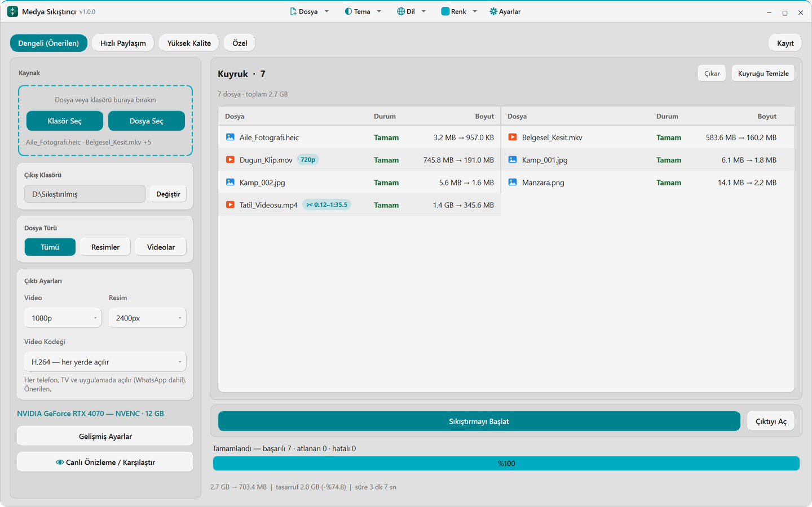
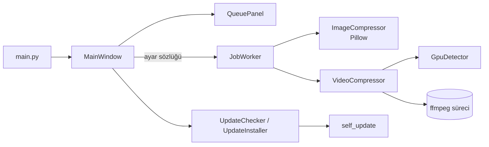

<div align="center">

[English](README.md) | Türkçe

# MediaCompressor

**Telefon ve kameradan gelen fotoğraf ve videoları, FFmpeg ve isteğe bağlı ekran kartı kodlamasıyla paylaşıma ya da arşive uygun boyuta küçültür.**


<picture>
  <source media="(prefers-color-scheme: dark)" srcset="docs/images/mediacompressor-dark.webp">
  
</picture>

</div>

> Yukarıdaki pencerede uydurma dosya adları ve boyutlar var. Arayüz Türkçe ve İngilizce olarak sunulur; ekran görüntüsü Türkçedir.

## Öne Çıkanlar

- **Fotoğraf ve video tek kuyrukta.** Dosya ya da klasörleri bırakırsınız; her dosyanın kendi durumu ve boyut farkı görünür, iş sonunda toplam kazanç ve geçen süre yazılır.
- **Ayar yerine profil.** Dengeli (Önerilen), Hızlı Paylaşım, Yüksek Kalite ve Özel. Bir değeri elle değiştirdiğinizde profil kendiliğinden Özel'e geçer.
- **H.264, HEVC ya da AV1 video.** H.264 çıktısı her zaman 8-bit 4:2:0'dır; iPhone HDR gibi 10-bit kaynaklar yaygın cihazlarda açılan dosyalara dönüşür. Video hiçbir zaman büyütülmez.
- **Ekran kartı çalışıyorsa ekran kartı, çalışmıyorsa işlemci.** NVIDIA NVENC, AMD AMF ve Intel QSV kendiliğinden algılanır; donanım denemesi başarısız olursa yeniden denenir, en sonunda işlemci kodlayıcısına geçilir.
- **Canlı önizleme ve karşılaştırma.** Kalite çubuğunu oynatırken sonucu görürsünüz; Boşluk tuşuna basılı tutarak orijinale geçersiniz.
- **Kırpma ve dosyaya özel istisna.** Videonun yalnızca bir bölümünü sıkıştırabilir, seçili dosyalara kendi çözünürlüğünü, kare hızını ya da ses ayarını verebilirsiniz.
- **Hiçbir şey ezilmez.** Çıktı önce geçici dosyaya yazılır, bitince asıl adına taşınır; çıkış klasöründe zaten var olan dosya atlanır. Orijinallere dokunulmaz, silinmez.

## Özellikler

### Video

| Ayar | Seçenekler |
| --- | --- |
| Girdi kapsayıcıları | `.mp4`, `.mov`, `.mkv`, `.avi`, `.m4v` |
| Kodek | H.264 (her yerde açılır), H.265 / HEVC (aynı kalitede daha küçük), AV1 (en küçük, yalnızca yeni cihazlar açar) |
| Kalite | Kalite değerine (CRF) bağlı otomatik bitrate ya da sabit bitrate (1500k, 2000k, 2500k, 4000k) |
| En Yüksek Çözünürlük | 720p, 1080p, 1440p, Orijinal ya da kendi yazdığınız değer. Yalnızca genişliği sınırlar; daha küçük video olduğu gibi kalır |
| Kare Hızı | Orijinal, 60, 30, 25 ya da 24 fps. Yalnızca düşürür |
| Ses | 96k, 128k ya da 192k; ya da sesi tamamen kaldırma |
| Hız | "Çok hızlı"dan "Daha yavaş"a; varsayılan "Yavaş" (daha iyi sıkıştırma) |
| Kırpma | Videoya sağ tık > **Kırp…**: başlangıç ve bitiş seçilir (iki uçtaki kare görünür), yalnızca o bölüm sıkıştırılır |

Kapsayıcı davranışı: uzantı korunur. `.avi` her zaman `.mp4` olur; AV1 seçilince `.mov` da `.mp4` olur, çünkü bu kapsayıcılar sonucu taşıyamaz. Çıktı kaynaktan küçük olmayacaksa orijinal kopyalanır (kırptıysanız ya da sesi kaldırdıysanız kopyalanmaz).

### Resim

| Ayar | Seçenekler |
| --- | --- |
| Girdi biçimleri | JPEG, PNG, WebP, HEIC / HEIF, AVIF, JPEG XL |
| Kalite | Otomatik (dosya boyutuna göre seçilir) ya da sabit değer |
| En Büyük Boyut | 1920 px, 2400 px, 3840 px, Orijinal ya da kendi yazdığınız değer; en uzun kenara uygulanır |
| Çıktı biçimi | JPEG JPEG kalır, WebP WebP, AVIF AVIF, JPEG XL JPEG XL. HEIC / HEIF ve saydamlığı olmayan PNG dosyaları JPEG olur; saydamlığı olan PNG dosyaları PNG (palet) kalır |
| Üst veri | EXIF yönü uygulanır; JPEG çıktısında EXIF ve ICC profili, diğer biçimlerde ICC profili korunur |

Canlı önizleme, bir kalite değerine karar vermeden önce aynı resmi JPEG, WebP, AVIF ve JPEG XL olarak karşılaştırabilir.

### Kuyruk ve Çalışma Akışı

| Özellik | Ayrıntı |
| --- | --- |
| Dosya ekleme | Sürükle-bırak, **Dosya** menüsü (**Dosya Seç…**, **Klasör Seç…**); alt klasörler isteğe bağlı |
| Kuyruk | Sürükleyerek sıralama, kuyruktan çıkarma (orijinal dosya silinmez), **Hatalıları Tekrar Dene**; pencere genişse iki sütun |
| İstisna | Seçili dosyalara sağ tık > **İstisna Uygula**: kendi çözünürlüğü, kare hızı ya da sesi (koru / kaldır). İş sürerken henüz başlamamış dosyalara da verilebilir |
| Kalan Süre | Dosya sayısına değil iş miktarına (bayt) göre tahmin edilir; resim ve video hızı ayrı ölçülür; ilk %1'den sonra gösterilir |
| Çıkış | Seçtiğiniz klasör ya da masaüstündeki `sıkıştırılmış` klasörü (arayüz İngilizceyse `compressed`) |
| Ayarlar | Çözünürlük, kodek, kalite, ses, kare hızı, hız, GPU ve diğer seçimler yeniden açılışta aynı kalır |
| Tepsi | Uygulama sistem tepsisinde yaşar; pencereyi kapatmak gizler. Tepsi menüsü: Göster/Gizle, Ayarlar, Tema, Dil, Çıkış. İş bitince masaüstü bildirimi verilir |
| Görünüm | Sistem, açık ya da koyu tema; birkaç vurgu rengi; Türkçe ve İngilizce |

### Güncelleme ve Duyurular

Otomatik denetim açıkken uygulama günde bir kez `macik.com.tr`'ye yeni sürüm olup olmadığını sorar. Varsa başlık çubuğunda ve tepsi menüsünde **Güncelle · vX** düğmesi çıkar; güncelleme indirilir, sunucunun verdiği SHA-256 sağlama toplamıyla doğrulanır, açılır ve yerinde değiştirilir. **Güncellemeleri Otomatik Kur** açıksa uygulama kullanılmıyorken bu arka planda olur. Yeni sürüm açılışta iki kez ölürse önceki sürüm geri getirilir ve o sürüm bir daha önerilmez. Sunucu ayrıca pencerenin üstünde gösterilen, kapatılabilen tek satırlık bir duyuru da gönderebilir.

İki anahtar da **Ayarlar**'dadır. Kaynaktan çalıştırdığınız ya da kendi derlediğiniz sürüm de aynı adrese bakar; bunu istemiyorsanız `src/core/app_info.py` içindeki `UPDATE_CHECK_URL` ve `UPDATE_ALLOWED_HOSTS` değerlerini değiştirin.

## Kurulum

### Hazır Çalıştırılabilir Dosya

Windows sürümünü **<https://macik.com.tr>** adresinden indirin. Tek bir `.exe`'dir; kurulum gerekmez.

### Kaynaktan

Python 3.13 gerekir (kodun geliştirildiği ve denendiği sürüm).

```powershell
git clone https://github.com/Aseloth99/mediacompressor.git
cd mediacompressor
py -3.13 -m pip install -r requirements.txt
py -3.13 main.py
```

`requirements.txt` yalnızca çalıştırılabilir dosya derlemek için gereken PyInstaller'ı da içerir.

### FFmpeg

FFmpeg bu deponun parçası değildir. Uygulama `ffmpeg` ve `ffprobe`'u önce `PATH`'te, sonra kendi veri klasöründe (`%LOCALAPPDATA%\MediaCompressor\ffmpeg`), uygulamanın yanında (`ffmpeg` ya da `ffmpeg\bin` alt klasörü dahil) ve macOS ile Linux'ta olağan kurulum konumlarında (Homebrew, `/usr/bin`, ...) arar.

- **Windows:** hiçbiri bulunmazsa bir şeritte **FFmpeg İndir** düğmesi çıkar. Düğme [gyan.dev](https://www.gyan.dev/ffmpeg/builds/) üzerinden "release-essentials" derlemesini alır, yanında yayımlanan SHA-256 dosyasıyla doğrular ve uygulamanın veri klasörüne kurar. Düğmeye basmadığınız sürece hiçbir şey indirilmez. Kendi FFmpeg'inizi `PATH`'e koyup **Yeniden Tara**'ya (`F5`) da basabilirsiniz.
- **macOS / Linux:** FFmpeg'i paket yöneticinizle kurun (`brew install ffmpeg`, `sudo apt install ffmpeg`, ...) ve **Yeniden Tara**'ya basın.

Resimler FFmpeg'siz çalışır; video için FFmpeg gerekir. İndirdiğiniz ya da kurduğunuz FFmpeg derlemelerinin kendi lisans koşulları vardır.

## Kullanım

1. Fotoğraf, video ya da klasörleri pencereye bırakın ya da **Dosya Seç** / **Klasör Seç**'i kullanın.
2. Bir profil seçin. Daha ince ayar için **Gelişmiş Ayarlar**'ı (bitrate, kalite, hız, ses, kare hızı, GPU) açın ya da ana ekrandan kodeği ve çözünürlükleri ayarlayın.
3. Çıkış klasörüne bakın, sonra **Sıkıştırmayı Başlat**'a basın. **Durdur** işi bitirir; tamamlanmış dosyalar kalır.
4. İş bitince **Çıktıyı Aç** sonuçları gösterir; **Hatalıları Tekrar Dene** başarısız dosyaları yeniden kuyruğa alır.

Kuyruktaki bir dosyaya sağ tıklayınca **Canlı Önizleme / Karşılaştır**, **Kırp…** (videolar), **İstisna Uygula**, **Klasörde Göster** ve **Dosyayı Aç** çıkar.

Komut satırı: `MediaCompressor.exe --minimized` (ya da `py -3.13 main.py --minimized`) tepside gizli başlatır. **Açılışta Başlat** bunu kullanır. İkinci bir kopya açılırsa çalışan kopya öne gelir.

### Klavye Kısayolları

| Kısayol | İşlev |
| --- | --- |
| `Ctrl+O` | Dosya seç |
| `Ctrl+Shift+O` | Klasör seç |
| `Ctrl+,` | Ayarlar |
| `F1` | Hakkında |
| `F5` | FFmpeg'i yeniden tara |
| `Ctrl+Q` | Çıkış (pencerenin kapatma düğmesi ve `Alt+F4` tepsiye gizler) |
| `Delete` / `Backspace` | Seçili kuyruk girdilerini çıkar |
| `Space` (basılı tutulur, önizlemede) | Sıkıştırılmış sonuç yerine orijinali göster |

### Ayarlar

| Nerede | Seçenek |
| --- | --- |
| Ayarlar | Dil (Otomatik, Türkçe, English), Tema (Sistem, Koyu, Açık), Renk |
| Ayarlar | Açılışta Başlat (varsayılan kapalı), Bildirimleri Göster |
| Ayarlar | Güncellemeleri Otomatik Kontrol Et, Güncellemeleri Otomatik Kur, Kontrol Et |
| Ana pencere | Profil, Dosya Türü, Çıkış Klasörü, Video ve Resim sınırları, Video Kodeği, Bitince Klasörü Aç |
| Gelişmiş Ayarlar | Bitrate, Kalite (CRF), İşleme Hızı, Ses, Kare Hızı (FPS), GPU, Sesi Kaldır (Sessiz Video), Alt Klasörleri İşle (Sıkıştırılmış Hariç), Resim Kalitesi Otomatik |

Ayarlar `%APPDATA%\MediaCompressor\config.json` dosyasındadır; günlükler ve çökme kayıtları `%LOCALAPPDATA%\MediaCompressor\logs` içindedir. macOS ve Linux'ta uygulama `~/Library/Application Support` ile `~/Library/Logs` ya da XDG klasörlerini kullanır.

## Mimari

```
mediacompressor/
├── main.py                  giriş noktası: tek kopya kilidi, tema, tepsi, güncelleme denetçisi
├── MediaCompressor.spec     PyInstaller tanımı (Windows, tek dosya, pencereli)
├── pack_dist.py             dist\MediaCompressor.exe dosyasını dist\MediaCompressor.zip içine paketler
├── version_info.txt         Windows sürüm kaynağı (bir test app_info.VERSION ile eşitliğini denetler)
├── requirements.txt
├── assets/icons/            uygulama simgesi
├── docs/images/             README ekran görüntüleri
├── src/
│   ├── core/                sıkıştırma motoru
│   │   ├── app_info.py          ad, sürüm, güncelleme adresi, klasör adları
│   │   ├── ffmpeg_manager.py    FFmpeg'i bul / indir (SHA-256 denetimli)
│   │   ├── gpu_detector.py      NVENC, AMF, QSV, VAAPI, VideoToolbox sondajı ve yedek yollar
│   │   ├── video_compressor.py  FFmpeg komutu kurma, ilerleme ayrıştırma, GPU'dan CPU'ya düşme
│   │   ├── image_compressor.py  Pillow / piexif hattı (JPEG, PNG, WebP, HEIC, AVIF, JPEG XL)
│   │   ├── job_manager.py       JobWorker: kuyruğu çalıştırır, paralel resim, dosyaya özel istisna
│   │   ├── atomic_output.py     geçici dosya + yeniden adlandırma ile yazma
│   │   ├── eta.py               iş miktarına göre kalan süre tahmini
│   │   └── workers.py           arka plan işçisi tabanı ve güvenli kapanış
│   ├── gui/                 PyQt6 arayüzü
│   │   ├── main_window.py       ana pencere, profiller, ayar toplama, güncelleme akışı
│   │   ├── queue_panel.py       kuyruk listesi ve sağ tık menüsü
│   │   ├── preview_dialog.py    canlı önizleme ve karşılaştırma
│   │   ├── trim_dialog.py       video kırpma
│   │   ├── advanced_dialog.py, settings_dialog.py, update_dialog.py, about_dialog.py
│   │   ├── title_bar.py, chrome_dialog.py, message_box.py   çerçevesiz pencereler ve özel mesaj kutuları
│   │   ├── tray.py, notice_bar.py, drop_zone.py, icons.py, path_label.py, res_combo.py
│   └── utils/               ortak yardımcılar
│       ├── config.py            ayar dosyası (atomik kayıt, bozuk dosya karantinaya alınır)
│       ├── locales.py           Türkçe / İngilizce metinler
│       ├── theme_manager.py     açık / koyu temalar ve vurgu renkleri
│       ├── updater.py, update_installer.py, self_update.py, remote_notice.py   güncelleme akışı ve duyurular
│       ├── startup.py, autostart_unix.py   açılışta başlatma (Windows Run anahtarı, LaunchAgent, XDG autostart)
│       ├── process.py, notify.py, helpers.py, logger.py, crashlog.py, platform_utils.py, timecode.py
└── tests/                   unittest paketi (ekransız Qt)
```



## Çalıştırılabilir Dosyayı Derleme

Tanım dosyası Windows'u hedefler. Deponun kök klasöründen:

```powershell
py -3.13 -m pip install -r requirements.txt
py -3.13 -m PyInstaller MediaCompressor.spec --noconfirm --clean
py -3.13 pack_dist.py
```

PyInstaller komutu `dist\MediaCompressor.exe` üretir. `pack_dist.py` isteğe bağlıdır: çalıştırılabilir dosyayı, uygulama içi güncelleyicinin açtığı paket düzeniyle `dist\MediaCompressor.zip` içine koyar. Sürümü `src/core/app_info.py` ve `version_info.txt` içinde birlikte değiştirin; bir test ikisinin eşit olduğunu denetler.

## Testler

```powershell
$env:QT_QPA_PLATFORM = "offscreen"
py -3.13 -X utf8 -m unittest discover -s tests
```

Testler gerçek ayarlarınıza dokunmaz: `tests/_support.py` profil klasörlerini geçici bir dizine yönlendirir. Birkaç test, kuruluysa gerçek bir FFmpeg kullanır, değilse atlanır. Yalnızca Windows'ta çalışan bir test, mesaj kutusu yerleşimini denetlemek için ekranın çok dışında gerçek pencereler açar; atlamak için `MB_SKIP_REAL=1` verin.

## Platform Desteği

Windows birincil ve düzenli kullanılan tek platformdur. macOS ve Linux kod yolları (VideoToolbox ve VAAPI kodlayıcıları, LaunchAgent ve XDG ile açılışta başlatma, yerel bildirimler, FFmpeg arama) birim testleriyle kapsanır ama o sistemlerde hiç çalıştırılmamıştır; deneysel sayın.

## Lisans

Kaynak kod [MIT Lisansı](LICENSE) ile yayımlanmıştır.

Arayüz, GPL-3.0 ya da ticari lisansla sunulan PyQt6'yı kullanır. Buradaki kaynak kod MIT'tir; PyQt6 içeren ikililer dağıtırken bu ikililer için PyQt6'nın lisans koşulları geçerlidir. Pillow, piexif, pillow-heif, pillow-avif-plugin, imagecodecs ve NumPy kendi lisanslarını korur. FFmpeg ayrı bir programdır, kendi lisansı vardır ve pakete dahil değildir.
